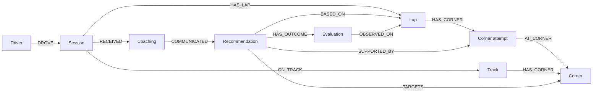

# Neo4j race memory

An Aura account needs a database instance before this works. In the [Aura console](https://console.neo4j.io/), open Instances and create an AuraDB Free instance if none exists. Wait for Running, save the generated password, and copy its connection URI. See the [official instance guide](https://neo4j.com/docs/aura/getting-started/create-instance/).

Put these fields in the project's `.env` (never in browser code or Git):

```dotenv
NEO4J_URI=neo4j+s://YOUR-INSTANCE.databases.neo4j.io
NEO4J_USERNAME=neo4j
NEO4J_PASSWORD=YOUR-GENERATED-PASSWORD
NEO4J_DATABASE=neo4j
```

Restart the server after editing `.env`; use `PORT=3100 npm run phone` to keep HTTPS phone steering available. Restarting changes the temporary phone URL, so scan the new QR code. The Neo4j JavaScript driver uses the server-side credentials. Queries use parameters, fixed labels, bounded result sizes and timeouts. Connection failures leave the local engineer usable.

## Verify without AI spending

Run `npm run memory:check`. Success returns `status: connected`; this also creates uniqueness constraints. `not_configured` means credentials are incomplete; `unavailable` means the driver could not complete a connection or query. Credentials and private database errors are never returned to the browser. Driver connection errors may need checking against the instance status and saved credentials.

Then open `/coach-lab.html`, turn **Engineer on**, leave **Automatic tips unchecked**, and click **Load 3 example laps into Neo4j**. The result should contain three laps and T4 loss totaling 0.67 seconds across three examples. Ask a question only when you want an ai& request. Responses must identify these as examples. `npm run memory:demo` does the same insertion and retrieval for a separate CLI demo driver.

Reload the practice page and ask about previous example laps to test retrieval across sessions. Repeating the load uses the same three lap IDs within a session; it does not duplicate them. A reload starts a new session, so loading again intentionally creates another session of examples.

## How the engineer uses it



On each coach request, the server retrieves up to five recent laps and three previous AI tips for the same driver, track and car mode. It includes measured corner losses and repeated problem corners in the AI prompt. Prior tips are advice, not evidence that the driver followed them. Completed AI replies and deterministic measured cues are saved as coaching records. Identical measured cues are deduplicated. Graph operations and measured cues use no LLM or embedding calls. Explicit questions and automatic tips without an eligible measured cue may use ai& credits.

The browser stores an anonymous driver ID in localStorage; clearing browser data creates a new driver. Sessions have fresh IDs on page reload. Live game and practice data use separate `live` and `demo` namespaces. Data stays in Aura until deleted there. These IDs scope application retrieval; they are not account authentication. Keep this prototype limited to trusted users.

Engineer **off** stops new lap writes and AI requests. Turning it on does not automatically spend AI credits. Existing graph writes already accepted by the database may finish after switching off. The **Check memory** button is an explicit database check and works without enabling AI.

## Structured analysis handoff

The existing `race:lap-summary` string event still works, storing text without inventing metrics. For graph comparisons, send a structured object with a stable ID per measured lap:

```js
window.dispatchEvent(new CustomEvent("race:lap-summary", {
  detail: {
    id: "session-lap-3",       // stable for retries; unique within this session
    lapNumber: 3,
    valid: true,               // false for crashes, cuts, resets or contaminated comparisons
    startedAt: lapStartEpochMs,
    completedAt: lapFinishEpochMs,
    comparison: {
      referenceId: "reference-lap-2", // exact reference used to calculate these deltas
      trackVersion: "suzuka-v1",
      physicsVersion: "physics-v1",
      setupId: "rocket-fans-on-assists-default" // change when relevant settings change
    },
    lapTimeSeconds: 132.4,
    summary: "T4 lost 0.35 s against the reference; braked 12 m early.",
    corners: [{
      name: "T4",             // stable across laps
      observedAt: cornerCompletedEpochMs,
      timeLostSeconds: 0.35,
      brakedEarlyMeters: 12,
      minimumSpeedDifferenceKmh: -6,
      throttlePickupLateMeters: 4
    }]
  }
}));
```

The timestamp variables above must come from the measured attempt, using `Date.now()` epoch milliseconds in the game browser (same machine/clock as the current Node server). Do not substitute upload time. A future distributed deployment needs clock synchronization. Evaluation requires the target corner's `observedAt` to be after the cue acknowledgment, or, if that timestamp is absent, the whole lap's `startedAt` must be after it. An old lap uploaded late is not evidence of responding to coaching. If timestamps are absent, laps remain available as history but cannot establish a post-cue outcome.

The four comparison identifiers and `valid: true` are required for automatic focus selection. Missing metadata does not silently inherit the latest reference or settings. Keep reference IDs immutable; changing best/reference laps starts a new comparison group. Setup IDs should distinguish relevant fans, assists, tires and other settings. Existing summaries without these fields still store normally.

Lap payloads are immutable: an identical retry with the same ID is safe; changing a previously stored payload returns `stored: false, reason: lap_id_conflict`. Corrections need a fresh lap ID. Legacy laps stored before payload hashes were added stay readable; resend revised analysis under a fresh ID.

These numbers are examples. Send only values actually measured by analysis; omit unavailable metrics. Positive `brakedEarlyMeters` means braking earlier, negative `minimumSpeedDifferenceKmh` means slower than reference, and positive `throttlePickupLateMeters` means later throttle. Up to 32 corners are accepted. The game sets the track ID from the selected level. Existing car/phone WebSocket messages are unchanged.

The browser telemetry pipeline produces real lap/corner measurements during circuit driving. The practice page demonstrates graph memory using labeled examples in a separate dataset.

To inspect the graph in Aura Query:

```cypher
MATCH (d:RaceDriver)-[:DROVE]->(s:RaceSession)-[:HAS_LAP]->(l:RaceLap)
WHERE d.dataset = 'demo'
OPTIONAL MATCH (l)-[:HAS_CORNER]->(a:RaceCornerAttempt)-[:AT_CORNER]->(c:RaceCorner)
RETURN d, s, l, a, c LIMIT 100
```

## Measured coaching loop

Open `/coach-lab.html`, turn Engineer on, leave automatic tips off, then:

1. Load the three example laps.
2. Click **Measured focus · no AI credits**. The cue should target T4, suggest braking 2 m later, and cite three comparable laps.
3. Send the next comparable example lap. The evidence card should report braking 2 m later and 0.06 s less time lost against the pre-cue lap.

Reload to start another example session. `npm run memory:loop-demo` verifies the graph flow using a fresh isolated demo driver, including exactly one evaluation, three evidence links, coaching links, duplicate protection and rejection of a changed payload. No ai& requests are made.

Selection examines the latest five stored laps. It requires the latest lap to be valid, matching reference/track/physics/setup identifiers, and at least two comparable laps with the same measured early-braking or late-throttle issue and a positive time loss. Candidates are ranked by mean measured loss multiplied by repeat frequency. It selects one corner and one action, capped at 5 m and half the latest error. This is a measured priority, not an estimate or promise of recoverable time. Minimum speed alone does not establish which action to take.

Evidence strength is labeled moderate or strong based on repetition (strong requires at least three supporting attempts and no contrary comparable lap in the window); it is not a calibrated probability. Rules and thresholds are in `CONFIG.coachingLoop`.

A proposed recommendation links its baseline lap, supporting corner attempts and target corner. The browser acknowledges only after displaying the card in a visible document. This marks it pending; it does not claim the driver heard, understood or followed it. The first subsequently received eligible matching attempt is compared, and an immutable Evaluation links to that lap. A browser acknowledgment is not identity/authentication or proof of user attention. Missing/invalid measurements, an unshown cue, older driving timestamps or different conditions cannot produce an outcome. **Clear this focus** records a dismissal rather than deleting evidence; use it if changing conditions or choosing another focus.

Outcomes distinguish reduced technique error plus reduced time loss, technique change alone, time improvement alone, unchanged results and more time lost. Overshooting the reference by more than the original error is not counted as technique improvement. Results describe one observational comparison, never proof that advice caused improvement.

The AI receives this structured focus and outcome for questions and explanation; it does not calculate the deltas. Automatic measured cues are deterministic (`source: analysis`). The existing voice scheduler waits for a straight or a stop. The browser telemetry pipeline supplies the lap/corner measurements used by this recommendation/evaluation loop.

To inspect evidence and outcomes:

```cypher
MATCH (r:RaceRecommendation)-[:SUPPORTED_BY]->(a:RaceCornerAttempt)
OPTIONAL MATCH (r)-[:HAS_OUTCOME]->(e:RaceEvaluation)-[:OBSERVED_ON]->(l:RaceLap)
RETURN r, a, e, l LIMIT 100
```
